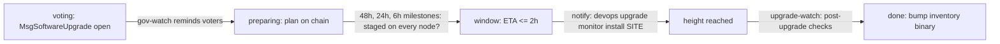

# Automations

What runs by itself, what only reminds, and what always waits for a person.

## The model

The hub (the machine with this workspace) runs every automation. It reaches
hosts over outbound ssh and the chain over public HTTPS. Hosts never call
back, and nothing on a host runs on a schedule because of this workspace,
except transient watchers a human starts (the upgrade monitor).

When the hub sleeps, nothing is checked. Jobs record the gap (`> gap: previous
run was 9h12m ago`) so a report never implies continuous coverage. If you need
24/7 alerting, run the same workspace on an always-on machine (a small VPS or
a home server) with `devops cron install --crontab`.

## Jobs

| Job | When | Does | Never |
|---|---|---|---|
| hourly-health | every hour | `checks/run.sh hourly all` | restarts |
| daily-network | 08:15 | daily group (validator, patches drift, secrets audit, app.toml, certbot, archive growth, structs.app, inventory freshness) | applies patches |
| tls-expiry | 07:45 | `tls-expiry` + `certbot` checks | runs certbot |
| new-updates | 09:00 | fetches `.references` (hub-local), `new-releases`, commit subjects per moved repo | pulls images on hosts |
| gov-watch | every 6 h | announces new proposals once; reminds while an inventory voter has not voted | votes |
| upgrade-watch | every 30 min | upgrade lifecycle milestones (below) | stages binaries, recreates, installs monitors |
| pipeline-watch | hourly :37 | `devops pipeline watch`: notifies when a pipeline trigger moved; `on_change: prepare` pipelines also prepare stages in hub clones ([docs/pipelines.md](pipelines.md)) | pushes, tags, deploys |
| weekly-digest | Mon 09:30 | non-OK checks, hub gaps, tx log, journal entries of the week | — |

`devops cron list|status|run <job>|logs <job>|install|uninstall`. Schedules live in
`crons/schedules.yaml`; install writes launchd agents on macOS or crontab lines
elsewhere.

## Chain upgrade lifecycle

1. **Voting.** `gov-watch` announces the proposal and reminds until every voter in `network.yaml gov.voters` has voted. A human runs `devops gov show <id>` and `devops gov vote <id> <option> --as <site>.<account>` (simulates, then tier 3).
2. **Preparing.** Once the plan is on chain, `upgrade-watch` posts milestones at 48, 24 and 6 hours with the `upgrade-plan` check, which lists nodes missing `upgrades/<name>`. Staging is a human step per node (`runbooks/chain-upgrade.md`: pull the new image, verify the digest and `upgrades.conf.sh`, recreate structsd), each a tier-2 action.
3. **Window.** At 2 hours and 30 minutes it asks for a monitor per node site: `devops upgrade monitor install <site>` (tier 1, a transient systemd unit that logs `===UPGRADE-FIRED===`, `===POSSIBLE-HALT===`, `===RECOVERED===`).
4. **After.** When the plan is gone and `applied_plan` reports a height, it runs block-progress, height-agreement, node-health, app-toml, containers, sync-lag and tsa-queue across all sites and reminds you to update `binary.*` (in `networks/<preset>.yaml`, or as an override in your `network.yaml`) and `images.structsd`, then `devops inventory render`.

## Notifications

`DEVOPS_NOTIFY` in `.devops.env` is a comma list of channels: `stdout`,
`macos`, `ntfy`, `discord`, `matrix`, `webhook`. Channel credentials go in
`local/secrets.env` (`NTFY_URL`, `DISCORD_WEBHOOK_URL`, `MATRIX_HOMESERVER`,
`MATRIX_ROOM_ID`, `MATRIX_ACCESS_TOKEN`, `NOTIFY_WEBHOOK_URL`). Checks notify
on status changes only, with a CRIT reminder every `DEVOPS_CRIT_REMIND_HOURS`.

## What is deliberately not automated

| Action | Why it waits for a person |
|---|---|
| Governance votes | A vote is a signed, public statement by the guild. Crons only remind. |
| Any broadcast (`devops tx --broadcast`) | Irreversible; always simulated first and gated at tier 3. |
| Restarts, recreates, deploys | Service-affecting; tier 2 with an approval token, `--yes-public` on the public node. |
| Pipeline pushes, release tags | A push starts GitHub builds (Pages, desktop releases); a tag ships to players. `devops pipeline publish` is tier 2, tier 3 with a tag. |
| certbot renewals by hand | On the public node, the renewal pre_hook stops Caddy; certbot's own timer handles renewals. |
| Migration re-pins | Migrations track `structs-pg` `main` on the guild sites by design; never pin to a commit. |
| Patch re-application | Drift is reported daily; `devops patches <site> apply` is tier 1 but still a human decision because drift can mean upstream changed the file on purpose. |
