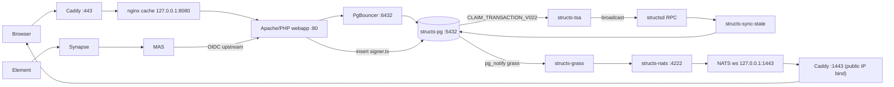

# Data flows

Every Structs problem lives on one of five paths. Find the path, then test it hop by hop from the outside in; the first hop that fails is where to look. Container names below are the defaults (`docker-structs-guild-<service>-1`); `devops inventory env <site>` prints the real ones.

## 1. Web path (player webapp)

| Hop | Where | Listens | Notes | Test |
|---|---|---|---|---|
| Caddy | host systemd `caddy`, `/etc/caddy/Caddyfile` | `:443`, `:80` (308 redirect) | `admin off`: reload fails, always validate then restart (blips every site on the host ~1 s). Certificates from Caddy ACME. | `devops debug http-trace <site> /` hop `caddy-loopback` |
| nginx cache | `structs-webapp-cache` (nginx 1.27) | `127.0.0.1:8080` | 5 s global microcache on GET `/api/*`, URL-only key, `/api/auth/logout` uncached. Passes Caddy's `X-Forwarded-For` through unchanged. Adds `X-Cache-Status`. Access log in combined format with the forwarded client address appended (`nginx-top` reads it). | hop `nginx-8080`; `devops debug nginx-top <site>` |
| Apache/PHP | `structs-webapp` (Symfony, no host port) | `:80` in the container network | `MaxRequestWorkers 450` (bind-mounted `mpm_prefork.conf`). Source bind-mounted from `/root/structs-webapp/src`. | hop `apache-in-container`; `devops check apache-workers <site>` |
| PgBouncer | `structs-pg-bouncer` | `:6432` (container network) | Transaction pool 30 for alias `structs`, pool 8 for alias `structs_app`. Client side `sslmode=disable`; server side `server_tls_sslmode=require`. Auth from `config/pgbouncer/userlist.txt`. | `devops debug pg <site> bouncer` |
| Postgres | `structs-pg` | `127.0.0.1:5432` on the host, `:5432` in the network | `max_connections 100`, hostssl only for TCP. Admin access is over the container socket (`docker exec -u postgres`). | `devops debug pg <site> connections` |

Webapp DSN (through the bouncer): `postgres://structs_webapp@structs-pg-bouncer:6432/structs?sslmode=disable`.

The local Docker site has no Caddy or nginx cache; the webapp is published directly (`DIRECT_WEBAPP_HTTP_PORT`).

## 2. Chain to database (indexer)

| Hop | Where | Notes |
|---|---|---|
| structsd RPC | The guilds index from the public node (`https://public.testnet.structs.network:26657`). Their local `structsd` is a validator for block production only. | `devops check block-progress`; `devops debug compare-nodes` |
| sync-state | `structs-sync-state` (`/src/scripts/sync_state.sh` from the `structs/structs-pg` image), role `structs_indexer`, `SYNC_STATE_DB_MAX_CONNS=4`, `SYNC_POLL_INTERVAL=3s` plus push notification. | Holds a writer lock: never scale it to two. Never replay history into a live database (see the 2026-09-28 incident). |
| tables | `sync_state.sync_cursor`, `block_log`, `handler_error_log`, `unknown_event_log`; derived `structs.api_*` tables rebuilt per block; `structs.ledger` hypertable. | `devops debug pg <site> sync-state`, `ledger-sanity` |
| auto-migrate | `structs-pg-auto-migrate` fetches `structs-pg` `main` every 120 s and runs `sqitch deploy` to `latest`. | `devops debug pg <site> migrations`; never re-pin to a commit |

## 3. Realtime events (GRASS)

| Hop | Where | Notes |
|---|---|---|
| Postgres notify | Triggers call `pg_notify('grass', …)`. | |
| GRASS | `structs-grass`, `LISTEN "grass"` as `structs_indexer`, publishes to `nats://structs-nats:4222` as user `grass_pub` (`NATS_PUB_PASSWORD`). | Chronic `unhealthy` is known on some guilds; list it in `checks.ignore_unhealthy`. |
| NATS | `structs-nats`: client `4222`, monitor `8222`, websocket `1443`, all on loopback. The websocket has `no_auth_user: reader` (subscribe only). | `devops debug grass-tap <site>` |
| Caddy `:1443` | Binds the host's public IP explicitly (docker-proxy holds `127.0.0.1:1443`), proxies to `127.0.0.1:1443`. | A plain HTTPS GET returns **400**: that is healthy (TLS fine, not a websocket upgrade). |
| Browser | `wss://<host>:1443`, advertised in `guild.json` as `grass_nats_websocket`. | Mixed content if the bundle has `ws://`: rebuild with the HTTPS patch. |

## 4. Signing (TSA)

| Hop | Where | Notes |
|---|---|---|
| request | The webapp inserts rows into `signer.tx` (`status=pending`). | No dedupe today: a client retry loop can queue hundreds of identical requests. |
| claim | `structs-tsa` workers call `signer.CLAIM_TRANSACTION_V022(account)`. Connects **directly** to `structs-pg:5432` as `structs_webapp`. The account agents stay off the pooler on purpose; never rewrite the TSA `DATABASE_URL` to the bouncer. | `application_name=structs-tsa-v022`. `TSA_WORKERS=6` on 4 cores. |
| eligibility | `AUTHORIZED_ACCOUNTS_V022` -> `MEMBERSHIP_CONTEXT_CHECK` -> `PROXY_CONTEXT_CHECK_V022` -> `PERMISSION_CHECK`, against `signer.local_key` rows fresh within 120 s. | Rows that never pass stay `pending` forever and are re-checked on every claim. |
| sign + save | Keys in the `tsa-keyring` volume (`/var/structs/accounts`). `save_signed_transaction_v022` rejects when `source_height < indexed_height`. | Never delete or recreate the keyring volume. |
| broadcast | `signer.tx_submission` tracks `prepared -> sending -> accepted/rejected -> committed`. | `devops debug pg <site> signer-queue` |

## 5. Identity (Matrix and OIDC)

| Hop | Where | Notes |
|---|---|---|
| Synapse | `/root/structs-tel` stack, `matrix.<host>` -> `127.0.0.1:8008`, federation `:8448`. | `signing.key` must be owned by uid 991. |
| MAS | `auth.<host>`. Upstream OIDC provider is the webapp. Talks to Postgres over TLS (needs an X.509 v3 cert). | |
| Webapp OIDC | Issuer `https://<host>`, `/.well-known/openid-configuration`, `/oauth/jwks`, `/oauth/token`. Needs `OIDC_ENABLED=true`, `OIDC_ENCRYPTION_KEY`, `MATRIX_SIGNIN_CLIENT_ID`; client secret matches `structs-tel/.env` and is **hex**. | `devops debug oidc-probe <site>` (400 `invalid_grant` = healthy) |

## Side paths

- **structs.app** (where a site runs it): Caddy `structs.app` -> `127.0.0.1:8437` -> `structs-app` container -> bouncer alias `structs_app` as the read-only role `structs_app`. 502 = container down; 503 = its database path (usually the `userlist.txt` row). `/healthz` can be OK while player and OG pages 503, so check both.
- **Crawler**: `structs-crawler` as `structs_crawler` reads every guild's on-chain endpoint manifest (`guild.json`, must be `application/json`) and sets `guild_meta.this_infrastructure` from `GUILD_ID`.
- **Public node**: Caddy terminates `:443` (RPC, LCD, swagger) and `:26657` (bind to the public IP); gRPC `:9090` is published directly and must listen on `0.0.0.0` in `app.toml`.

## Database roles

| Role | Used by | Path |
|---|---|---|
| `structs_webapp` | webapp; also the TSA (today) | webapp via bouncer; TSA direct |
| `structs_indexer` | sync-state, GRASS | direct |
| `structs_crawler` | crawler | direct |
| `structs_app` | structs.app (read only) | bouncer alias `structs_app` |
| `structs_tsa` | exists, unused (planned home for the TSA) | |
| `postgres` | migrations, admin, `devops debug pg` | container socket |
| Synapse and MAS roles | Matrix (their own databases on the same server) | direct |

The guild Postgres server is shared with Synapse and MAS, so a connection storm from the webapp can stall Matrix too. Example budget: webapp pool 30 (+5 reserve) and structs.app 8 (+2) leave about 55 of the 100 slots for Synapse, MAS, indexer, TSA, crawler, GRASS, and TimescaleDB workers.

More in [postgres-reference.md](postgres-reference.md). Symptoms map to hops in [symptom-index.md](symptom-index.md).
