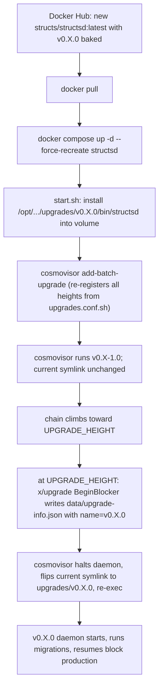

# Chain upgrade runbook

Use this when a new `structsd` version (e.g. `v0.19.0`) has been released by `playstructs/structsd` and a corresponding `structs/structsd:latest` image has been pushed to Docker Hub with the new binary baked in.

This playbook was validated against the **v0.17.0 → v0.18.0 ("Stellarine")** upgrade on 2026-06-14.

## Variables

Set these at the top of your session:

```bash
NEW=v0.19.0                          # the new upgrade plan name (must match on-chain plan name exactly)
UPGRADE_HEIGHT=1234567                # from the governance proposal
EXPECTED_DIGEST=sha256:xxxxxxxx...    # from Docker Hub or release notes
```

## Mental model — how the swap actually fires



Key invariants you are relying on:

1. The new image ships the v0.X.0 binary at `/opt/structs/cosmovisor/upgrades/v0.X.0/bin/structsd`.
2. The new image's `/root/scripts/upgrades.conf.sh` includes the entry `"v0.X.0:UPGRADE_HEIGHT"`.
3. The on-chain governance proposal has **passed** and `structsd query upgrade plan` returns it.
4. `DAEMON_ALLOW_DOWNLOAD_BINARIES=false` — the binary MUST be in the image; no fallback download.

## Steps

### 0. Confirm prereqs

```bash
# upgrade plan must already be on-chain
docker exec docker-structs-guild-structsd-1 /usr/bin/structsd query upgrade plan \
  --node http://127.0.0.1:26657 -o json | jq '{name, height}'
# expected: { "name": "v0.X.0", "height": "UPGRADE_HEIGHT" }

# how many blocks away
curl -s http://127.0.0.1:26657/status | jq -r '.result.sync_info.latest_block_height'
# rough rate: ~6s/block on this chain → blocks_remaining * 6 / 3600 = ETA hours
```

If `query upgrade plan` returns empty: the governance proposal hasn't been submitted or passed. The chain will sail through `UPGRADE_HEIGHT` without doing anything. Get the proposal submitted first.

### 1. Pre-flight the new image (no service impact)

```bash
ssh root@<public-node-ip>
docker pull structs/structsd:latest

# Confirm digest matches the published one
docker image inspect structs/structsd:latest --format '{{index .RepoDigests 0}}'
# Expected: structs/structsd@$EXPECTED_DIGEST

# Inspect the new image WITHOUT touching the running container
docker run --rm --entrypoint sh structs/structsd:latest -c '
  set -e
  echo --- upgrades dir ---
  ls /opt/structs/cosmovisor/upgrades/
  echo --- v0.X.0 binary version ---
  /opt/structs/cosmovisor/upgrades/v0.X.0/bin/structsd version
  echo --- upgrades.conf.sh ---
  cat /root/scripts/upgrades.conf.sh
'
```

**ABORT** and report back if:

- `v0.X.0/bin/structsd` is missing
- `upgrades.conf.sh` does NOT contain `"v0.X.0:UPGRADE_HEIGHT"`
- The reported binary version doesn't match `v0.X.0`

### 2. Backups

```bash
cd /home/docker/docker-structs-guild
STAMP=$(date +%Y%m%dT%H%M%S)
cp compose.yaml compose.yaml.bak.$STAMP
cp .env .env.bak.$STAMP
VOL=/var/lib/docker/volumes/structsd-chaindata/_data
cp -a "$VOL/config/app.toml" "$VOL/config/app.toml.bak.$STAMP"
cp -a "$VOL/data/upgrade-info.json" "$VOL/data/upgrade-info.json.bak.$STAMP" 2>/dev/null || true
readlink "$VOL/cosmovisor/current"   # record current symlink (e.g. upgrades/v0.X-1.0)

# Record the OLD image digest in case you need to roll back
docker inspect docker-structs-guild-structsd-1 --format '{{.Image}}' > /tmp/old-image-digest.$STAMP
cat /tmp/old-image-digest.$STAMP
```

Chaindata itself does NOT need a full copy — we're swapping the image, not state.

### 3. Bust the batch marker so all 3 upgrades re-register

```bash
rm -f /var/lib/docker/volumes/structsd-chaindata/_data/data/upgrade-info.json.batch
```

This makes the new `start.sh` re-run `cosmovisor add-batch-upgrade` with the full list from the new `upgrades.conf.sh`. Skipping this leaves an old batch file that only knows v0.X-1.0 and earlier. Not strictly required for the live upgrade (cosmovisor will still detect the on-chain plan), but defense in depth for catch-up syncs.

### 4. Recreate the container

```bash
cd /home/docker/docker-structs-guild
docker compose up -d --force-recreate --no-deps structsd
```

The container will start, run `start.sh`, install all three upgrade binaries into the chaindata volume (idempotent), re-register the batch, and launch cosmovisor on the **old** binary (v0.X-1.0) since the chain hasn't reached UPGRADE_HEIGHT yet.

### 5. Post-recreate verification

```bash
# container healthy
docker ps --filter name=structsd-1 --format '{{.Status}}\t{{.Image}}'

# new binary staged in volume
docker exec docker-structs-guild-structsd-1 ls -la /root/.structs/cosmovisor/upgrades/
docker exec docker-structs-guild-structsd-1 /root/.structs/cosmovisor/upgrades/v0.X.0/bin/structsd version

# symlink still on previous upgrade
docker exec docker-structs-guild-structsd-1 ls -la /root/.structs/cosmovisor/current

# batch file regenerated with all three upgrades
cat /var/lib/docker/volumes/structsd-chaindata/_data/data/upgrade-info.json.batch | jq .

# sync resumed
curl -s http://127.0.0.1:26657/status | jq '.result.sync_info | {latest_block_height, catching_up}'

# cosmovisor logs report the binary is staged for the upgrade
docker logs --tail 60 docker-structs-guild-structsd-1 2>&1 \
  | grep -E "Upgrade binary located|Registering batch upgrades"
```

PASS criteria:
- container `(healthy)` within ~2 minutes
- `/root/.structs/cosmovisor/upgrades/v0.X.0/bin/structsd` exists, reports `version v0.X.0`
- `cosmovisor/current` still → `upgrades/v0.X-1.0`
- `catching_up: false`
- log line: `Upgrade binary located at .../upgrades/v0.X.0/bin/structsd` and `v0.X.0 upgrade binary will switch at height UPGRADE_HEIGHT`

### 6. CRITICAL — re-apply app.toml customizations

A `--force-recreate` with a new image WILL trigger the `network-config.sh` template-overwrite on `app.toml` if the new image bumped the docker-config marker version. See [post-recreate-app-toml-fix.md](post-recreate-app-toml-fix.md) for the full story.

```bash
# Run the idempotent patcher (always safe)
bash /root/apply-app-toml-overrides.sh    # if you've copied it to the host

# Then restart to apply
docker compose restart structsd
```

Or check manually that nothing changed:

```bash
VOL=/var/lib/docker/volumes/structsd-chaindata/_data
diff "$VOL/config/app.toml.bak.$STAMP" "$VOL/config/app.toml"
```

### 7. Install the upgrade monitor

```bash
# pull scripts/upgrade-monitor.sh into /root/upgrade-monitor.sh on the host, then:
scp scripts/upgrade-monitor.sh root@<public-node-ip>:/root/upgrade-monitor.sh
ssh root@<public-node-ip> chmod +x /root/upgrade-monitor.sh

# edit TARGET= and LOG= path to match the new version, then launch under systemd:
ssh root@<public-node-ip> 'systemctl reset-failed structsd-upgrade-monitor.service 2>/dev/null || true
  systemd-run --unit=structsd-upgrade-monitor --no-block \
    --description="watch v0.X.0 cosmovisor swap" /root/upgrade-monitor.sh'

# verify
ssh root@<public-node-ip> systemctl status structsd-upgrade-monitor.service --no-pager
```

The monitor will tail to `/var/log/structsd-v0.X.0-monitor.log`. Tail it locally with:

```bash
ssh root@<public-node-ip> 'tail -F /var/log/structsd-v0.X.0-monitor.log'
```

Configure your terminal/agent to wake on `===UPGRADE-FIRED===` or `===POSSIBLE-HALT===`.

### 8. Auto-swap (no action needed)

When the chain reaches `UPGRADE_HEIGHT`:

1. The running v0.X-1.0 daemon's `x/upgrade` BeginBlocker writes `data/upgrade-info.json` with `name=v0.X.0`.
2. The daemon exits with code 0 (cosmovisor knows this means upgrade).
3. Cosmovisor:
   - re-points `cosmovisor/current → upgrades/v0.X.0`
   - re-execs `/root/.structs/cosmovisor/current/bin/structsd start ...`
4. The new binary runs its in-app migrations (re-stamp planetary struct health, etc.) and resumes block production.

### 9. Post-upgrade verification

Run as soon as the monitor fires `===UPGRADE-FIRED===`:

```bash
docker exec docker-structs-guild-structsd-1 ls -la /root/.structs/cosmovisor/current
# → upgrades/v0.X.0

docker exec docker-structs-guild-structsd-1 cat /root/.structs/data/upgrade-info.json | jq '{name, height}'
# → name=v0.X.0, height=UPGRADE_HEIGHT

docker exec docker-structs-guild-structsd-1 /usr/bin/structsd version
# → 0.X.0

curl -s http://127.0.0.1:26657/status | jq '.result.sync_info | {latest_block_height, catching_up}'
# → height > UPGRADE_HEIGHT, catching_up: false

# look for migration logs
docker logs --tail 200 docker-structs-guild-structsd-1 2>&1 \
  | grep -Ei "migrat|module=|UPGRADE|panic|FATAL"
```

If `catching_up: false` and height keeps climbing past `UPGRADE_HEIGHT + 100` blocks, the upgrade is successful. Stop the monitor:

```bash
ssh root@<public-node-ip> systemctl stop structsd-upgrade-monitor.service
```

### 10. Rollback (only if step 5 fails BEFORE UPGRADE_HEIGHT)

If the new image swap breaks the still-running pre-upgrade binary (rare; usually it's a perfect drop-in):

```bash
cd /home/docker/docker-structs-guild
docker compose down structsd
OLD_DIGEST=$(cat /tmp/old-image-digest.$STAMP)   # captured in step 2
docker pull "structs/structsd@$OLD_DIGEST"
sed -i.bak "s|image: .structs/structsd:latest.|image: \"structs/structsd@$OLD_DIGEST\"|" compose.yaml
docker compose up -d --no-deps structsd
```

This restores the previous image while keeping the chaindata volume intact.

**Rolling back AFTER the chain has crossed UPGRADE_HEIGHT is not possible** without a state export/import dance — the old binary will refuse to process blocks past the upgrade height.

## Common failure modes

See:
- [post-recreate-app-toml-fix.md](post-recreate-app-toml-fix.md) — app.toml settings vanish after recreate
- [cosmovisor-recovery.md](cosmovisor-recovery.md) — UPGRADE NEEDED loop, AppHash mismatch, symlink-stuck-on-old-binary
